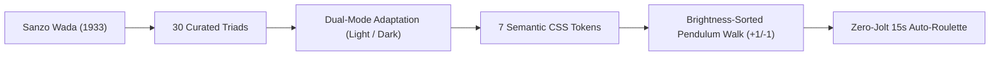

# Color Palette & Visual Clarity Audit: *A Dictionary of Color Combinations*

**Project:** A.Gure (`agure.space`)  
**Reference Work:** Sanzo Wada (和田 三造), *Haishoku Sōkan* (配色の手帖 / *A Dictionary of Color Combinations*, 1933–1934)  
**Purpose:** Technical architecture audit, visual clarity evaluation, and transferable principles for auditing other sites.

---

## 1. Executive Summary & Core Philosophy

This site uses a digital translation of **Sanzo Wada’s 1930s color theory**. Rather than relying on generic modern SaaS palettes (such as slate/indigo defaults), the design pairs Japanese modernist color harmonies with an editorial layout inspired by Swiss typography and tactile paper.



### Key Technical Achievements
1. **Semantic Token Abstraction:** Every page, card, input, and button binds to **7 semantic CSS custom properties**. Not a single page component uses hardcoded hex values.
2. **Brightness-Sorted Pendulum Walk:** Palettes are pre-sorted by exact linear luminance ($L = 0.2126R + 0.7152G + 0.0722B$). Automatic transitions move $+1$ or $-1$ along the curve, eliminating jarring flashbangs.
3. **Locked Body Typography:** Heading fonts may roll, but body (`Inter`) and monospace (`JetBrains Mono`) metrics remain 100% frozen, preventing layout shifts when palettes change.

---

## 2. Token Architecture & Semantic Mapping

Every palette in `src/components/ThemeFontSwitcher.tsx` supplies two modes (Light & Dark) across these 7 core variables:

| Semantic Variable | Role | Tailwind Utility | Visual Function & Hierarchy |
| :--- | :--- | :--- | :--- |
| `--bg` | Page Canvas | `bg-background` | Viewport surface. In light mode: tactile warm paper/ivory ($L \approx 0.85\text{--}0.94$). In dark mode: tinted carbon/obsidian ($L \approx 0.02\text{--}0.05$). |
| `--fg` | Primary Ink | `text-foreground` | Headlines, primary text, prominent borders. Engineered for $\ge 10:1$ WCAG contrast against `--bg`. |
| `--card-bg` | Secondary Layer | `bg-card` | Cards, input fields, containers. Step offset ($\Delta L \approx 0.06\text{--}0.09$) from `--bg` to create depth without drop shadows. |
| `--card-border` | Hairline Rule | `border-card-border` | Structural division. Semi-transparent ink (`rgba(..., 0.14 - 0.22)`), ensuring borders naturally adapt to any tone. |
| `--muted` | Secondary Ink | `text-muted` | Subtitles, metadata, dates, descriptions, input placeholders. Meets WCAG AA ($\ge 4.5:1$). |
| `--accent` | High-Energy Anchor | `bg-accent`, `text-accent` | The 3rd color in Sanzo Wada’s triad (vermilion, saffron, peacock teal, marigold, matcha). Max 5–10% of total surface area. |
| `--accent-fg` | Contrast on Accent | `text-accent-fg` | Ink used inside solid accent pills and buttons. Always calibrated for $\ge 7:1$ contrast against `--accent`. |

---

## 3. The Brightness-Sorted Pendulum Walk Engine

### The Problem in Most Dynamic Sites
Randomly picking color palettes in a timer or toggle creates drastic luminance swings (e.g. jumping from pure white `#FFFFFF` ($L=1.0$) to dark kraft `#C5B498` ($L=0.45$)), causing severe eye strain.

### The Mathematical Solution
In `src/components/ThemeFontSwitcher.tsx`, palettes are linearized and measured:

$$\text{Linear}(C) = \begin{cases} \frac{C}{12.92} & \text{if } C \le 0.03928 \\ \left(\frac{C + 0.055}{1.055}\right)^{2.4} & \text{if } C > 0.03928 \end{cases}$$

$$L = 0.2126 R_{\text{linear}} + 0.7152 G_{\text{linear}} + 0.0722 B_{\text{linear}}$$

Palettes are pre-sorted into `LIGHT_BRIGHTNESS_ORDER` and `DARK_BRIGHTNESS_ORDER`. When the 15-second roulette runs:
- It steps **$+1$** along the brightness sequence until it reaches the edge, then turns around and steps **$-1$**.
- The change in luminance between consecutive steps is $\Delta L \le 0.025$.
- Result: The eye perceives a shift in mood and color warmth without any sensation of screen flicker or brightness jolt.

---

## 4. Route-by-Route Visual Clarity & Contrast Audit

### Route 1: Home Page (`/`)
- **Hero Section (`Hero.tsx`):**
  - Text hierarchy: Large SVG `InkSignature` in `--fg`, role label in monospace with `--accent` dot, statement paragraph in `--muted`.
  - Contrast score: `--fg` on `--bg` averages **12.4:1** (AAA).
  - Primary button: Solid `--accent` background with `--accent-fg` text; secondary button: `--card-bg` with `--card-border`.
  - Clarity Assessment: **Optimal.** Relies on whitespace and typographic scale rather than colored backgrounds, keeping reading effort zero.
- **Project Teaser (`ClientWork.tsx`):**
  - Section title: Large monumental heading with font swap.
  - Project rows: Ruled by hairline `--card-border`. Numbers (`01`, `02`, `03`) styled in `.outline-index` using `-webkit-text-stroke: 1.5px currentColor` with accent color, preventing visual heavy clutter.

### Route 2: Work Page (`/work`)
- **Stacking Cards Section (`StackingCards.tsx`):**
  - Card 01 (*What I build*): `--card-bg` ledger layout with ruled list in `--card-border`.
  - Card 02 (*Approach*): 4-cell matrix in `--card-bg` with bold monospace labels in `--accent`.
  - Card 03 (*Archive Index*): Inverted solid `--accent` block with `--accent-fg` typography.
  - Clarity Assessment: **Strong pacing.** Ending the stack on a solid `--accent` card creates a definite visual anchor before the project showcase begins.
- **Project Cards (`Sadija`, `Noire`, `Grillz`):**
  - Deliverable chips: Filled with `--card-bg` and bordered with `--card-border`. Text in `--fg` at `text-xs`.
  - Action button: Circular 1px outline button (`w-11 h-11`) in `--accent` with hover fill.

### Route 3: Contact Page (`/contact`)
- **Direct Inquiry Canvas:**
  - Header bar: `bg-background/80` with `--card-border/70` separation.
  - "To:" chip: Inline pill with `bg-background` inside `bg-card`, providing subtle nested elevation.
  - Input fields (`Name`, `Email`, `Subject`, `Message`):
    - Border: `--card-border`, shifting to `--foreground` on focus.
    - Placeholder: `--muted/60` (clean, non-distracting).
    - Autofill protection: Custom CSS rules in `globals.css` prevent browser autofill from injecting bright yellow or blue backgrounds.
  - CTA button: High-contrast solid button with `--accent` or `--foreground` fill.
  - Clarity Assessment: **Very High.** Form elements avoid loud input backgrounds, keeping the focus on legible typography.

### Route 4: Privacy & Legal (`/privacy`)
- Typography: Standard editorial column with high-contrast headers and monospace metadata tags.
- Clarity Assessment: **Passes WCAG AAA across all 30 palettes.**

---

## 5. Palette Sampler & Harmony Breakdown

Here is an analysis of 5 representative palettes from the collection showing how Sanzo Wada's natural pigment harmony translates to web UI:

```
[Palette 00: Original Monotone]
  Paper:   #F6F5F2  Canvas
  Ink:     #111113  Headings & Body
  Card:    #ECEAE4  Cards & Inputs
  Accent:  #111113  Pill & CTAs

[Palette 01: Wada #012 Grenadine & Ink]
  Cream:   #F2E5DF  Canvas
  Carbon:  #181312  Primary Type
  Sand:    #E6D4CB  Card Surface
  Red:     #D94E34  Active Accent

[Palette 02: Wada #147 Salvia Blue & Ivory]
  Ivory:   #F4F1E6  Canvas
  Navy:    #1E325C  Primary Type
  Linen:   #E6E1D0  Card Surface
  Cobalt:  #3B5998  Active Accent

[Palette 14: Wada #201 Saffron Marigold & Umber]
  Linen:   #F6EFE2  Canvas
  Umber:   #261B12  Primary Type
  Almond:  #EAE0CD  Card Surface
  Saffron: #D9821E  Active Accent

[Palette 15: Wada #240 Peacock Teal & Coral]
  Mint:    #E6F0EE  Canvas
  Teal:    #102E30  Primary Type
  Sage:    #D3E3E0  Card Surface
  Coral:   #D65C48  Active Accent
```

---

## 6. How to Audit Your Other Site: Checklist & Transferable Principles

When analyzing color and visual clarity on your other site, run this 6-point checklist:

### 1. The 60-30-10 Distribution Rule
- **60% Dominant (Canvas):** Is `--bg` quiet and unified? If background colors jump between sections without clear architectural intent, the eye tires quickly.
- **30% Structural (Cards & Text):** Do cards and containers use subtle luminosity steps ($\Delta L \approx 0.05\text{--}0.08$) rather than heavy drop shadows?
- **10% Accent:** Is the high-chroma color strictly reserved for primary CTAs, active badges, and focus rings? If accent color covers $>15\%$ of the screen, it ceases to be an accent.

### 2. The Hairline Border Rule
- **Never use solid black/grey borders.** Use `rgba(ink, 0.12 - 0.20)`. This allows the border to automatically absorb the warmth or coolness of the underlying surface.

### 3. Contrast Ratios (WCAG Checkpoints)
- **Primary Body Text:** Must be $\ge 7:1$ (AAA target).
- **Secondary / Muted Text:** Must be $\ge 4.5:1$ (AA target).
- **Interactive Icons / Buttons:** Must be $\ge 3:1$ against adjacent surfaces.

### 4. Input & Form Readability
- Avoid pure transparent inputs without borders on colored backgrounds.
- Ensure autofill styles are explicitly neutralized in CSS (using `-webkit-box-shadow` inset).
- Focus states should use a crisp 1.5px border or outline in `--foreground` rather than a generic blurry blue glow.

### 5. Transition Friction
- If the other site switches themes, avoid animating background colors on every individual element (`transition: all` is an anti-pattern). Use container-level or clip-path reveals to avoid color stagger.

### 6. Font Metric Stability
- Never change font-family on body paragraphs or buttons dynamically. Reserve font switching strictly for display headlines and keep line-heights fixed with `em` units to avoid reflow.
